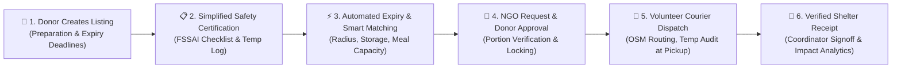
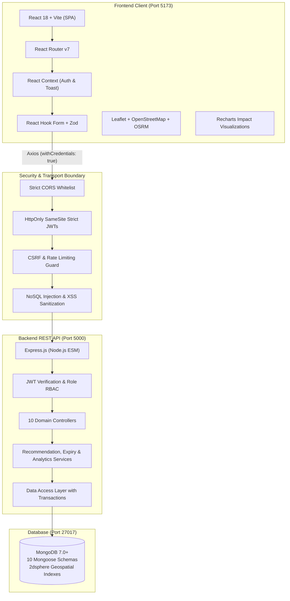

<div align="center">

# 🌿 FOODLINK
### Smart Surplus Food Redistribution & Zero-Waste Logistics Platform
**Localized for Karnataka State, India • Compliant with FSSAI (Surplus Food) Regulations, 2019**

[-F7DF1E?logo=javascript&logoColor=black)](#)
[](#)
[](#)
[](#)
[](#)
[](#)
[](#)
[](#)

<p align="center">
  <strong>Bridging surplus food to hungry communities — safely, transparently, and swiftly.</strong><br>
  An enterprise-grade, full-stack food rescue management platform engineered strictly in pure JavaScript, eliminating food waste while upholding the highest hygiene and temperature standards across Karnataka, India.
</p>

[Quick Start](#-quick-start-guide-ubuntu-linux) •
[Interactive Roles](#-the-foodlink-ecosystem-roles) •
[Rescue Workflow](#-end-to-end-food-rescue-lifecycle) •
[Architecture](#-architecture--technology-stack) •
[Test Results](#-testing--quality-assurance) •
[Documentation](#-documentation-index)

---

</div>

## 📌 Executive Overview

Every day, commercial kitchens, wedding halls, IT cafeterias, and bakeries prepare wholesome, nutrient-rich meals that go unconsumed, while community shelters and vulnerable families struggle with food insecurity. **Foodlink** solves this coordination failure by providing an intelligent, real-time rescue logistics bridge.

### 🎯 Key Guiding Principles
* **100% Pure JavaScript (ESM + JSX)**: Engineered without TypeScript complexity or bloated Docker orchestration for maximum developer ergonomics, fast build times, and seamless local execution on Ubuntu Linux.
* **Karnataka State & Republic of India Localization**: Completely localized geographic entities (Bengaluru, Mysuru, Hubballi), local addresses, pincodes, and regional cuisines (Bisi Bele Bath, Curd Rice, Mysuru Pak, Vegetable Saaru).
* **FSSAI Statutory Legal Shield**: Built in strict adherence to the **Food Safety and Standards (Recovery and Distribution of Surplus Food) Regulations, 2019** under Section 16(5) of the **Food Safety and Standards Act, 2006 (FSSA)**, legally protecting food donors acting in good faith.
* **Explainable Matching Engine**: Matches donations to recipient NGOs via an explainable, multi-factor heuristic scoring algorithm (distance, dietary flags, capacity, refrigeration, hot holding). Zero reliance on costly black-box AI APIs.
* **End-to-End Chain of Custody**: Digitally signed declarations, mandatory temperature logs at packing, pickup, and shelter intake, with concurrency-safe assignment locking.
* **Honest Data Integrity**: Platform impact metrics count **only** confirmed delivered food (`status === 'delivered'`). Unapproved or undelivered food is never counted as rescued.

---

## 🔄 End-to-End Food Rescue Lifecycle

The platform coordinates a 6-stage lifecycle across donors, recipient charities, logistics volunteers, and administrators:



---

## 👥 The Foodlink Ecosystem (Roles)

| Role | Target Users | Key Capabilities & Features |
| :--- | :--- | :--- |
| **🍲 Food Donor** | Restaurants, Hotels, Caterers, Bakeries, IT Parks | • 4-step donation wizard with 1-click FSSAI safety checklist certification<br>• Real-time urgency countdowns (`Critical`, `Urgent`, `Moderate`)<br>• Claim queue management (accept or reject NGO requests with audit reasons)<br>• Donor rescue history ledger with meals saved and CO₂ offsets |
| **🏢 Recipient NGO** | Food Banks, Community Shelters, Orphanages, Trusts | • Intelligent recommendations ranked by composite compatibility score (0–100)<br>• Transparent match breakdown (distance, category, storage, urgency)<br>• 1-click portion claim requests with real-time status updates<br>• Inbound rescue tracking and delivery receipt confirmation |
| **🛵 Delivery Partner** | Verified Volunteer Couriers, Community Drivers | • Live available rescue board within service radius<br>• Concurrency-safe atomic assignment claims (prevents double-booking)<br>• Leaflet & OpenStreetMap interactive route visualization<br>• Chain of custody handoffs: pickup signoff + NGO receipt confirmation |
| **🛡️ Administrator** | Foodlink Operations & Compliance Team | • NGO verification desk: inspect registration certificates, approve/reject/suspend<br>• Platform-wide monitoring: live donations, active requests, courier assignments<br>• Food safety audit oversight & user feedback moderation<br>• Aggregate platform analytics derived from verified database records |
| **👥 Public Beneficiary** | Citizens, Volunteers, Individuals in Need | • Open public food discovery board (`/available-food`) requiring zero login<br>• Sanitized privacy projections (donor personal contacts securely withheld)<br>• Search and filter by Karnataka city, food category, and dietary preferences |

---

## 🏛️ Architecture & Technology Stack



### Full Stack Composition
* **Frontend**: React 18, Vite 6, Tailwind CSS, Lucide React, Recharts, React Leaflet, OpenStreetMap, OSRM Routing.
* **Backend**: Node.js (ES Modules), Express 4, Zod schema validation, Morgan logging, Winston logger.
* **Database & Persistence**: MongoDB 7.0+, Mongoose 8 with ACID multi-document transactions and `2dsphere` geospatial indexing.
* **Security & Tokens**: Stateless dual-token architecture (15-min Access Token + 7-day Refresh Token) delivered exclusively via HttpOnly, Secure, SameSite cookies. **Tokens are never exposed in localStorage**.
* **Zero External Paid Dependencies**: Free OpenStreetMap tiles, OSRM routing with fallback straight-line calculation, local MongoDB.

---

## 🚀 Quick Start Guide (Ubuntu Linux)

### 1. Prerequisites
Ensure your Ubuntu environment has Node.js and MongoDB installed:
```bash
# Verify Node.js (v18.x or v20.x+)
node -v

# Verify npm (v9.x or v10.x+)
npm -v

# Verify MongoDB is running locally on port 27017
mongosh --eval "db.runCommand({ ping: 1 })"
```

### 2. Clone and Navigate
```bash
cd /home/srujan/FOODLINK
```

### 3. Configure Environments
Both Frontend and backend provide complete pre-configured `.env.example` templates:
```bash
# Configure Backend
cd backend && cp .env.example .env

# Configure Frontend
cd ../Frontend && cp .env.example .env
```

### 4. Install Dependencies
```bash
# Install backend dependencies
cd /home/srujan/FOODLINK/backend && npm install

# Install Frontend dependencies
cd /home/srujan/FOODLINK/Frontend && npm install
```

### 5. Seed Clean Karnataka Platform Data
Run the automated seed script to purge legacy data and provision verified Karnataka demo accounts and authentic surplus listings:
```bash
cd /home/srujan/FOODLINK/backend
npm run seed
```

### 6. Launch Development Servers
Open two terminal windows:

```bash
# Terminal 1: Backend API (http://localhost:5000)
cd /home/srujan/FOODLINK/backend
npm run dev

# Terminal 2: Web Client (http://localhost:5173)
cd /home/srujan/FOODLINK/Frontend
npm run dev
```

Visit **`http://localhost:5173`** in your browser!

---

## 🔑 Pre-Seeded Karnataka Demo Credentials

You can log in directly using the 1-click **Demo Accounts Pre-fill** buttons on the [`/login`](http://localhost:5173/login) page, or enter credentials manually:

| Role | Demo Email | Password | Entity / Organization Name | Location |
| :--- | :--- | :--- | :--- | :--- |
| **🛡️ Administrator** | `admin@foodlink.org` | `AdminSecure123!` | Karnataka Foodlink Administration | Bengaluru Hub (`+91 80 2558 0001`) |
| **🍲 Food Donor** | `donor@foodlink.org` | `Password123!` | Mavalli Tiffin Room (MTR) | Lalbagh Road, Bengaluru (`560027`) |
| **🏢 Recipient NGO** | `ngo@foodlink.org` | `Password123!` | Bengaluru Annapoorna Seva Trust | Indiranagar, Bengaluru (`560038`) |
| **🛵 Volunteer Courier** | `courier@foodlink.org` | `Password123!` | Basavaraj Gowda (Vehicle: `KA-04-NB-4421`) | Koramangala, Bengaluru (`560034`) |

---

## 🧪 Testing & Quality Assurance

Foodlink maintains a comprehensive test suite of **152 automated tests** verifying every functional requirement, edge case, and security boundary:

```bash
# Run all backend unit, API, concurrency & E2E tests (128 passing tests)
cd /home/srujan/FOODLINK/backend
npm test -- --run

# Run all frontend component, hook & integration tests (24 passing tests)
cd /home/srujan/FOODLINK/Frontend
npm test -- --run

# Compile the production frontend bundle
cd /home/srujan/FOODLINK/Frontend
npm run build
```

### Test Suite Summary
```
Backend Test Suites (Vitest):
✓ src/tests/health.test.js               (3 tests)
✓ src/tests/models.test.js               (11 tests)
✓ src/tests/auth.test.js                 (18 tests)
✓ src/tests/api.test.js                  (27 tests)
✓ src/tests/donations.test.js            (12 tests)
✓ src/tests/ngoMatching.test.js          (12 tests)
✓ src/tests/deliveryAndAdmin.test.js     (14 tests)
✓ src/tests/phase7Analytics.test.js      (15 tests)
✓ src/tests/phase8E2EWorkflow.test.js    (16 tests)
Total Backend Tests: 128 passed | 128 total (100% PASS)

Frontend Test Suites (Vitest + React Testing Library):
✓ src/tests/foundation.test.jsx          (4 tests)
✓ src/tests/phase4Donor.test.jsx         (3 tests)
✓ src/tests/phase5Ngo.test.jsx           (3 tests)
✓ src/tests/phase6DeliveryAdmin.test.jsx (5 tests)
✓ src/tests/phase7Frontend.test.jsx      (5 tests)
✓ src/tests/phase8E2EFrontend.test.jsx   (4 tests)
Total Frontend Tests: 24 passed | 24 total (100% PASS)

Overall System Status: 152 / 152 Tests Passing (100% Success)
```

---

## 📂 Project Directory Structure

```
FOODLINK/
├── backend/
│   ├── src/
│   │   ├── config/            # Database connection, env loader, CORS configuration
│   │   ├── constants/         # Roles, donation statuses, categories, HTTP status codes
│   │   ├── controllers/       # 10 Express controllers (Auth, Donation, Request, Assignment, Admin...)
│   │   ├── middleware/        # JWT auth, role RBAC, rate limiting, error handler
│   │   ├── models/            # 10 Mongoose schemas (User, Donation, Request, Assignment...)
│   │   ├── repositories/      # Data access layer with pagination & populates
│   │   ├── routes/            # REST route routers mounted under /api/v1
│   │   ├── scripts/           # seedAll.js (Karnataka dataset) & seedAdmin.js
│   │   ├── services/          # Matching engine, expiry service, analytics, assignment logic
│   │   ├── tests/             # 9 Vitest integration and security test suites
│   │   ├── utils/             # AppError, token utilities, MongoDB transactions
│   │   └── validators/        # Zod request validation schemas
│   ├── .env.example
│   ├── package.json
│   └── vitest.config.js
├── Frontend/
│   ├── src/
│   │   ├── app/               # main.jsx, App.jsx, AppRoutes.jsx
│   │   ├── components/        # UI library (Button, Card, Input, Modal, MapComponent, UrgencyBadge)
│   │   ├── constants/         # Routes, roles, categories, navigation items
│   │   ├── context/           # AuthContext (user state), ToastContext (notifications)
│   │   ├── hooks/             # useAuth, useToast, useNotifications
│   │   ├── layouts/           # AppLayout, RoleLayouts, Header, Footer, Sidebar
│   │   ├── pages/             # 35+ pages across Public, Donor, NGO, Delivery, and Admin
│   │   ├── services/          # Axios HTTP clients for all backend micro-services
│   │   ├── styles/            # Tailwind base directives and custom scrollbar/effects
│   │   └── tests/             # 6 Vitest frontend component test suites
│   ├── .env.example
│   ├── index.html
│   ├── package.json
│   ├── tailwind.config.js
│   └── vite.config.js
└── docs/                      # 16 Comprehensive Technical Architecture & Operation Guides
```

---

## 📖 Documentation Index

For in-depth architectural specifications, compliance details, and operational runbooks, refer to the documentation in `/docs`:

1. 🏗️ **[System Architecture & Lifecycle](file:///home/srujan/FOODLINK/docs/architecture.md)** – Detailed architectural breakdown, component interactions, and data flow.
2. 🐧 **[Ubuntu Linux Installation Guide](file:///home/srujan/FOODLINK/docs/ubuntu-installation-guide.md)** – Step-by-step setup on Ubuntu desktop/server environments.
3. ⚙️ **[Environment Configuration Guide](file:///home/srujan/FOODLINK/docs/environment-configuration-guide.md)** – Complete reference for all backend and frontend environment variables.
4. 🗄️ **[Database Setup & MongoDB Administration](file:///home/srujan/FOODLINK/docs/database-setup-guide.md)** – Geospatial indexes, seeding flows, backups, and recovery.
5. 📊 **[Database Schemas & Compound Indexes](file:///home/srujan/FOODLINK/docs/database-schema.md)** – Full Mongoose schema documentation and query optimization.
6. 📡 **[API Route Contracts & Specifications](file:///home/srujan/FOODLINK/docs/api-contracts.md)** – REST endpoints, request payloads, and status codes.
7. 🔒 **[Authentication & Security Architecture](file:///home/srujan/FOODLINK/docs/authentication-security.md)** – HttpOnly cookie strategy, CSRF prevention, and RBAC matrix.
8. 🧠 **[Smart NGO Matching & Scoring Engine](file:///home/srujan/FOODLINK/docs/ngo-smart-matching.md)** – Mathematical formula, distance scoring, and heuristic weights.
9. 🚚 **[Delivery Logistics & Administration](file:///home/srujan/FOODLINK/docs/delivery-and-admin.md)** – Assignment state machine, non-concurrency locking, and admin controls.
10. 📈 **[Impact Analytics, Notifications & SOPs](file:///home/srujan/FOODLINK/docs/analytics-notifications-safety.md)** – Verified metrics calculation, in-app notifications, and SOPs.
11. 🍲 **[Donor Experience & Automated Expiry](file:///home/srujan/FOODLINK/docs/donor-experience-expiry.md)** – Listing creation wizard, FSSAI declaration, and locking triggers.
12. 🔄 **[Comprehensive User Role Workflows](file:///home/srujan/FOODLINK/docs/user-workflows.md)** – Step-by-step user journey maps for all four roles.
13. 🧪 **[Testing & Quality Assurance Guide](file:///home/srujan/FOODLINK/docs/testing-guide.md)** – Automated test architecture, concurrency testing, and QA runbooks.
14. 🛠️ **[Troubleshooting & FAQ Guide](file:///home/srujan/FOODLINK/docs/troubleshooting-guide.md)** – Common error resolutions, port conflicts, and system FAQs.
15. 🎨 **[Design System & Style Guidelines](file:///home/srujan/FOODLINK/docs/design-system.md)** – Color tokens, typography, component standards, and visual identity.
16. ⚡ **[Quick Getting Started Reference](file:///home/srujan/FOODLINK/docs/getting-started.md)** – Condensed cheatsheet for rapid development onboarding.

---

<div align="center">

### 🌟 Together, Let's Make Hunger History in Karnataka!
Foodlink is dedicated to building sustainable, zero-waste food communities.

Made with ❤️ in Bengaluru, Karnataka, India.

</div>
