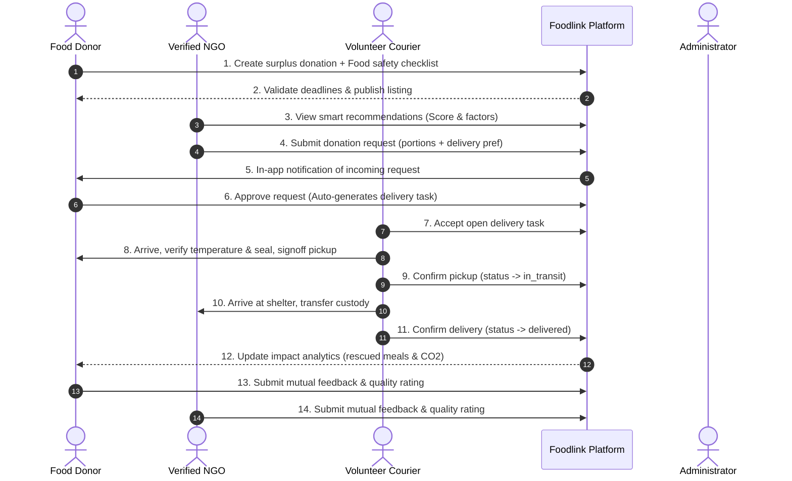

# Foodlink – User Role Workflows & Operation Manual

This guide describes the complete business workflows and user journeys across all authenticated roles and public beneficiaries.

---

## 1. Role Matrix Overview

| Role | Access Tier | Primary Capabilities |
| :--- | :--- | :--- |
| **Public Beneficiary** | Anonymous (No login) | Browse surplus food, filter by category/distance, view pickup instructions |
| **Food Donor** | Authenticated | Create listings, complete safety checklists, view recommendations, approve/reject claims |
| **NGO Partner** | Authenticated & Verified | View AI-free smart matches, claim available food, confirm reception, submit donor feedback |
| **Delivery Volunteer** | Authenticated | Claim open delivery assignments, verify pickup temperatures, confirm shelter drop-off |
| **Platform Administrator**| Authenticated (Pre-seeded) | Audit NGO verification documents, suspend/activate accounts, moderate reviews, monitor ESG analytics |

---

## 2. Complete Lifecycle Workflow (A through M)

---

## 3. Public Beneficiary Journey

1. **Discovery**: Navigate to `/available-food` without logging in.
2. **Filtering**: Filter available listings by category (e.g. Cooked Meals, Bakery, Produce) or proximity.
3. **Safety & Instructions**: View food details, preparation time, remaining pickup hours, allergen declarations, and collection instructions.
4. **Privacy Protection**: Donor exact contact phone and internal operational details remain protected.

---

## 4. Food Donor Journey

1. **Registration & Onboarding**: Register at `/register` with role `donor`.
2. **New Listing Creation**:
   - Fill in food name, category, quantity, unit, preparation date, and storage requirements.
   - Enter pickup address and geographic coordinates.
   - Complete mandatory **Food Safety Checklist** (commercial kitchen certification, temperature at packing, allergen declaration, and legal donor confirmation).
   - Set future pickup deadline and expiry date.
3. **Smart Matching**: System evaluates verified local NGOs within service radius and calculates transparent compatibility scores.
4. **Request Decision**: Donor reviews incoming NGO claims, portion requests, and intended beneficiary count. Approving locks the donation to the NGO and auto-generates a delivery mission.
5. **Impact Dashboard**: Monitor live ESG metrics (portions diverted from landfill, kilograms rescued, estimated CO₂ offset).

---

## 5. Verified NGO Partner Journey

1. **Registration & Verification**: Register at `/register` with role `ngo`. Complete organization profile detailing shelter capacity, storage capabilities (refrigeration, freezer, hot holding), and accepted categories.
2. **Admin Verification**: Administrative team reviews credentials and marks status as `verified`.
3. **Smart Recommendations**: Access `/ngo/recommended` to see listings ranked by distance, storage compatibility, and pickup feasibility.
4. **Donation Request**: Submit a portion request with intake rationale and delivery preference (`volunteer_delivery` or `self_pickup`).
5. **Intake & Sign-off**: Upon courier arrival, confirm seal integrity and temperature, and submit mutual feedback.

---

## 6. Volunteer Delivery Courier Journey

1. **Registration**: Register at `/register` with role `delivery`. Set vehicle type (bicycle, car, van, refrigerated truck).
2. **Task Discovery**: Access `/delivery/available` to view unassigned rescue missions with pickup and destination map markers.
3. **Atomic Claim**: Claim task with concurrency protection preventing multiple couriers from claiming simultaneously.
4. **Pickup Confirmation**: Arrive at donor facility, record temperature reading in Celsius, verify packaging seal, and record donor staff signoff name.
5. **Transit & Drop-off**: Transport food directly to NGO shelter, record recipient signoff name, and mark assignment completed.

---

## 7. Platform Administrator Journey

1. **Authentication**: Access pre-seeded administrator account at `/login`.
2. **NGO Verification Console**: Inspect pending NGO profiles, review documents, and approve or reject with custom feedback.
3. **Account Governance**: Suspend or reactivate users found in violation of food safety protocols.
4. **Feedback Moderation**: Audit community reviews and toggle visibility (`public` / `hidden`) or delete inappropriate comments.
5. **Platform Analytics**: Monitor real-time charts powered by Recharts detailing platform rescue volume, completion rates, and network participation.

